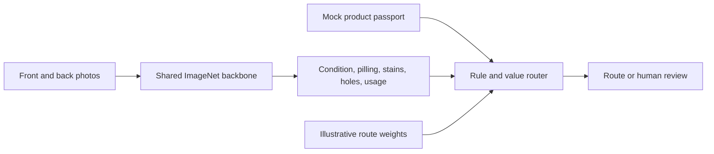

# Second-life garment routing

Author: Madhusudan Pareek

Used textiles are sorted by hand into a next life: reuse, export, repair, remake, or recycling. A wrong bin throws away resale value, or sends a damaged garment back into a shop. This project looks at the front and back of a garment, estimates condition and damage, combines that with a mock digital product passport, and recommends a route. It is trained on labels from expert sorters at Swedish facilities, reports how often it agrees with them, and sends uncertain garments back to a person. The intended use is research and a portfolio demonstration for the TU/e EngD theme on digital textile ecosystem identification and orchestration. It is not a certified sorter and it is not evidence for an extended producer responsibility filing on its own.

The code is MIT. The photographs and labels are not. They come from the Clothing Dataset for Second-Hand Fashion, CC-BY 4.0, collected by Wargön Innovation and Myrorna and released by RISE under the EU CISUTAC project. See the citation below.

**Weights (public):** [MadnessOverloaded/garment-routing-front](https://huggingface.co/MadnessOverloaded/garment-routing-front) — front-only ConvNeXt-Tiny pack with real eval numbers on the model card.

## Architecture



Station 3 (Myrorna) is never used for training or for choosing the confidence threshold. Every JSON file under `test100` is held out, and so is any other file whose comment contains `Test`. That hold-out is a set of annotation files, not a garment count. The results section states how many files that is, how many garments the numbered `Test` comments identify, and which files enter the annotator-agreement score. Splits are by annotation id, so the front and the back of one annotation stay together.

## Results

<!-- RESULTS:START -->
Floats below are read from `reports/results.json` and `reports/eda_summary.json` and shown to 3 decimal places. The JSON files keep full precision.

Rows in the index: 32036.
Gold-split annotation records: 399. The gold-set table below separates garments, JSON files, and annotation records.
Stratified split: true. Seed 42.

Near-duplicate fronts removed: 135. Test copies dropped because that front is also in train: 13.

Macro-F1, all 6 expert classes, averages F1 over Reuse, Export, Recycle, Repair, Remake, and Energy recovery.
Macro-F1, 4 training classes, averages F1 over Reuse, Export, Recycle, and Other, where Other groups Repair, Remake, and Energy recovery.

| Task | Split | Accuracy | Macro-F1 | MAE | Within 1 |
| --- | --- | --- | --- | --- | --- |
| majority 4 training classes | test | 0.487 | 0.164 | not computed | not computed |
| majority 4 training classes | cross_site | 0.975 | 0.247 | not computed | not computed |
| majority 6 expert classes | test | 0.487 | 0.109 | not computed | not computed |
| majority 6 expert classes | cross_site | 0.975 | 0.165 | not computed | not computed |
| majority stains_3class | test | 0.703 | 0.275 | not computed | not computed |
| majority stains_3class | cross_site | 0.921 | 0.320 | not computed | not computed |
| majority holes | test | 0.926 | 0.321 | not computed | not computed |
| majority holes | cross_site | 0.984 | 0.331 | not computed | not computed |
| majority condition | test | 0.358 | 0.105 | 0.934 | 0.708 |
| majority condition | cross_site | 0.171 | 0.058 | 1.102 | 0.726 |
| majority pilling | test | 0.574 | 0.146 | 0.768 | 0.769 |
| majority pilling | cross_site | 0.327 | 0.099 | 1.027 | 0.741 |

Cross-site majority label: Reuse. Accuracy 0.975 is that label's share of station 3, not a trained model. Macro-F1 on the same split is 0.247.
Station 3 usage is reported again in the station 3 section. There, balanced accuracy and macro-F1 come before accuracy.


### Gold set

The garment count times the mean equals the numbered annotation records. It does not equal the gold-split size. The numbered records, lowercase records of the same garments, and unnumbered comments add up to the gold-split size.

| Count | What it counts |
| --- | --- |
| 399 | Annotation records in the gold split. One record is one row of the index. |
| 399 | Distinct JSON files in the gold split. |
| 100 | Garments. One garment is one item number parsed from a comment matching `Test` plus digits. |
| 291 | Annotation records that carry such a number. The mean below divides this count by the garment count. |
| 2.910 | Mean numbered annotation records per garment. This is not the gold-split size. |
| 107 | Further annotation records of those same garments. The comment uses a lowercase `test` plus a number, which does not receive a garment id. The file is in the split because it is under `test100`. These records are not in the mean and not in the agreement pairs. |
| 1 | Annotation records in the gold split with no item number. The comment contains `Test`, so the file is held out of training. Each of these is one JSON file, not one of the numbered garments. Comment text: `Test for new update`. |

Expert versus expert, usage: Cohen's kappa 0.193 (95% CI 0.119–0.271), raw agreement 0.524, pairs 292. Those pairs come from 99 of 100 numbered garments. A garment with fewer than two numbered annotations contributes no pair. Lowercase `test` annotations are not in these pairs. Confidence intervals are garment-level bootstrap percentile intervals.
Expert versus expert, condition: Cohen's kappa 0.098, quadratic weighted kappa 0.308 (95% CI 0.202–0.410).
Model versus Wargön (Wargön photograph), usage Cohen's kappa: 0.079 (95% CI 0.017–0.152). Model versus Myrorna (same Wargön photograph), usage Cohen's kappa: 0.113 (95% CI 0.056–0.185).
Model versus Wargön, condition quadratic weighted kappa: 0.110 (95% CI -0.017–0.234). Model versus Myrorna, condition quadratic weighted kappa: 0.069 (95% CI -0.113–0.222).
Myrorna's gold photographs are missing from the archive, so its annotations are scored using the Wargön photograph of the same garment.

Numbered gold garments annotated at both Wargön and Myrorna: 96. Wargön is station 1 and station 2. Myrorna is station 3. Cross-site pairs join every Wargön annotation to every Myrorna annotation of the same garment. Within-Wargön pairs are unordered pairs of Wargön annotations on those same garments.
Usage Cohen's kappa, cross-site 0.186 (raw agreement 0.540, pairs 189), within Wargön 0.226 (raw agreement 0.485, pairs 99).
Condition quadratic weighted kappa, cross-site 0.279, within Wargön 0.310. Mean condition difference, Myrorna minus Wargön, -0.566. Mean absolute condition difference, cross-site 1.085, within Wargön 1.232.

Rows are the Wargön usage label. Columns are the Myrorna usage label. A garment with two Wargön annotations and one Myrorna annotation contributes two cells.

| Wargön route | Reuse | Export | Recycle | Repair | Remake | Energy recovery |
| --- | --- | --- | --- | --- | --- | --- |
| Reuse | 89 | 3 | 0 | 0 | 0 | 0 |
| Export | 30 | 13 | 4 | 0 | 0 | 0 |
| Recycle | 23 | 10 | 0 | 0 | 1 | 0 |
| Repair | 9 | 6 | 0 | 0 | 1 | 0 |
| Remake | 0 | 0 | 0 | 0 | 0 | 0 |
| Energy recovery | 0 | 0 | 0 | 0 | 0 | 0 |

Same view means the condition scores are equal. Same route means the usage labels are equal. Pairs with both fields present: 189.

| | Same route | Different route |
| --- | --- | --- |
| Same condition | 24 | 35 |
| Different condition | 78 | 52 |

Same condition and a different route: the sites give the garment the same condition score and a different usage label.
Different condition: the sites give the garment different condition scores.

Per-annotation front-only versus expert, usage Cohen's kappa: 0.073 (Wargön photographs only; Myrorna gold rows have no photographs).
Per-annotation two-view concat versus expert, usage Cohen's kappa: 0.106 (Wargön photographs only; Myrorna gold rows have no photographs).
Expert kappa minus chosen-model per-annotation kappa: 0.120.
The chosen model kappa is not within 0.05 of the expert-versus-expert kappa.

### Router on the expert damage labels

These scores give the router the sorter's own condition and damage labels, plus the dataset material field as a mock passport. They are not a vision result.

| Setting | Split | Accuracy | Macro-F1 |
| --- | --- | --- | --- |
| unconstrained | test | 0.476 | 0.127 |
| capacity | test | 0.495 | 0.137 |
| unconstrained | cross_site | 0.951 | 0.167 |
| capacity | cross_site | 0.970 | 0.189 |

### Attribute baselines

Photographs are not used. Macro-F1, all 6 expert classes, is the ceiling for a model that is given these annotation attributes and predicts usage. Material, type, brand frequency, and trend are annotation fields.
Features: condition, pilling, stains, holes, material, type, brand_frequency, trend.
Fit on train. Brand frequency: proportion of training rows with that brand string; a blank brand is one string; a brand absent from train is 0. LightGBM early stopping split: val. Permutation importance split: val. Seed 42.

| Model | Split | Macro-F1, all 6 expert classes | Macro-F1, 4 training classes |
| --- | --- | --- | --- |
| majority | test | 0.109 | 0.164 |
| rule router | test | 0.127 | 0.201 |
| logistic regression | test | 0.353 | 0.500 |
| lightgbm | test | 0.405 | 0.564 |
| majority | cross_site | 0.165 | 0.247 |
| rule router | cross_site | 0.167 | 0.255 |
| logistic regression | cross_site | 0.169 | 0.253 |
| lightgbm | cross_site | 0.161 | 0.241 |

Permutation importance is the drop in validation macro-F1, all 6 expert classes, when one feature is shuffled. Repeats: 5.

| Model | Feature | Mean drop in macro-F1, all 6 expert classes | Std |
| --- | --- | --- | --- |
| logistic regression | condition | 0.107 | 0.002 |
| logistic regression | material | 0.082 | 0.005 |
| logistic regression | stains | 0.023 | 0.003 |
| logistic regression | type | 0.013 | 0.006 |
| logistic regression | pilling | 0.008 | 0.002 |
| logistic regression | trend | 0.008 | 0.002 |
| logistic regression | brand_frequency | 0.005 | 0.002 |
| logistic regression | holes | 0.002 | 0.002 |
| lightgbm | condition | 0.137 | 0.005 |
| lightgbm | material | 0.097 | 0.009 |
| lightgbm | pilling | 0.041 | 0.015 |
| lightgbm | stains | 0.039 | 0.002 |
| lightgbm | type | 0.021 | 0.019 |
| lightgbm | holes | 0.015 | 0.004 |
| lightgbm | brand_frequency | 0.012 | 0.007 |
| lightgbm | trend | 0.003 | 0.003 |


### Station 3

On station 3 the primary metrics are balanced accuracy and macro-F1. Accuracy is secondary. Balanced accuracy is the mean recall over classes that occur in the scored rows.

Full station 3 split, uncorrected.

| Model | Balanced accuracy, 6 expert classes | Macro-F1, all 6 expert classes | Accuracy, 6 expert classes | Balanced accuracy, 4 training classes | Macro-F1, 4 training classes | Accuracy, 4 training classes |
| --- | --- | --- | --- | --- | --- | --- |
| majority | 0.167 | 0.165 | 0.975 | 0.250 | 0.247 | 0.975 |
| rule router | 0.287 | 0.167 | 0.951 | 0.422 | 0.255 | 0.951 |
| logistic regression | 0.238 | 0.169 | 0.782 | 0.366 | 0.253 | 0.783 |
| lightgbm | 0.218 | 0.161 | 0.737 | 0.327 | 0.241 | 0.737 |

Each corrected prediction is the argmax of p(y|x) times a station 3 class prior divided by the training class prior. The labelled sample is a simple random sample of station 3 garments and is excluded from the scored rows. Its raw class shares are reported even when a class count is zero. Laplace smoothing adds one count to every class before dividing, so a class missing from the sample stays possible. The EM prior (Saerens, Latinne, and Decaestecker, 2002) is estimated from each model's p(y|x) on the scored rows and does not use station 3 labels. If that p(y|x) already puts more mass on a rare class than the training prior, the EM estimate can concentrate on that class. The router values being reweighted are a softmax of the illustrative route scores.

Prior sample size 200. Seed 42. Scored rows 7155. Station 3 rows before the hold-out 7355.
Training class prior: Reuse 0.488 (n=8247), Export 0.407 (n=6889), Recycle 0.090 (n=1526), Repair 0.005 (n=80), Remake 0.007 (n=114), Energy recovery 0.003 (n=59).
Station 3 sample class prior: Reuse 0.980 (n=196), Export 0.020 (n=4), Recycle 0.000 (n=0), Repair 0.000 (n=0), Remake 0.000 (n=0), Energy recovery 0.000 (n=0).

Laplace-smoothed station 3 prior: Reuse 0.956, Export 0.024, Recycle 0.005, Repair 0.005, Remake 0.005, Energy recovery 0.005. Alpha 1.

Station 3 excluding the prior sample. Uncorrected, Laplace, and EM use these rows.

| Model | Variant | Balanced accuracy, 6 expert classes | Macro-F1, all 6 expert classes | Accuracy, 6 expert classes | Balanced accuracy, 4 training classes | Macro-F1, 4 training classes | Accuracy, 4 training classes |
| --- | --- | --- | --- | --- | --- | --- | --- |
| majority | uncorrected | 0.167 | 0.165 | 0.975 | 0.250 | 0.247 | 0.975 |
| majority | Laplace prior | 0.167 | 0.165 | 0.975 | 0.250 | 0.247 | 0.975 |
| majority | EM prior (no labels) | 0.167 | 0.165 | 0.975 | 0.250 | 0.247 | 0.975 |
| rule router | uncorrected | 0.287 | 0.167 | 0.950 | 0.422 | 0.255 | 0.950 |
| rule router | Laplace prior | 0.166 | 0.165 | 0.972 | 0.249 | 0.247 | 0.972 |
| rule router | EM prior (no labels) | 0.167 | 0.000 | 0.001 | 0.250 | 0.000 | 0.001 |
| logistic regression | uncorrected | 0.239 | 0.170 | 0.782 | 0.367 | 0.253 | 0.782 |
| logistic regression | Laplace prior | 0.207 | 0.177 | 0.905 | 0.391 | 0.267 | 0.905 |
| logistic regression | EM prior (no labels) | 0.106 | 0.040 | 0.132 | 0.284 | 0.060 | 0.132 |
| lightgbm | uncorrected | 0.217 | 0.161 | 0.737 | 0.326 | 0.241 | 0.737 |
| lightgbm | Laplace prior | 0.206 | 0.194 | 0.919 | 0.309 | 0.291 | 0.919 |
| lightgbm | EM prior (no labels) | 0.213 | 0.184 | 0.852 | 0.319 | 0.276 | 0.852 |

EM prior from each model's p(y|x) on the scored rows. Saerens, Latinne, and Decaestecker, Neural Computation 14(1), 2002. No station 3 labels.

| Model | Iterations | Converged | Prior |
| --- | --- | --- | --- |
| majority | 2 | true | Reuse 1.000, Export 0.000, Recycle 0.000, Repair 0.000, Remake 0.000, Energy recovery 0.000 |
| rule router | 27 | true | Reuse 0.000, Export 0.000, Recycle 0.000, Repair 1.000, Remake 0.000, Energy recovery 0.000 |
| logistic regression | 31 | true | Reuse 0.164, Export 0.000, Recycle 0.000, Repair 0.373, Remake 0.462, Energy recovery 0.001 |
| lightgbm | 23 | true | Reuse 0.805, Export 0.104, Recycle 0.052, Repair 0.010, Remake 0.025, Energy recovery 0.003 |


### Vision model

Front-only is the better model on test usage macro-F1, 4 training classes. Condition and pilling now use expected-level CORAL decoding; temperature is fit on log(T) and clamped to [0.05, 20].
Vision heads predict the 4 training usage classes. Macro-F1, all 6 expert classes, is not a vision output. Coverage-against-accuracy plots are in `reports/figures/`.
Model accuracy is below the majority baseline (0.463 vs 0.487) because macro-F1 is the target metric; majority wins accuracy by always predicting Reuse.
Selective coverage on test uses confidence signal `max_prob` (lowest AURC on val). AURC=0.457.
| Coverage | Accuracy | Accuracy 95% CI | Macro-F1 | Expert-vs-expert raw usage agreement (gold) |
| --- | --- | --- | --- | --- |
| 0.250 | 0.584 | 0.503–0.671 | 0.452 | 0.524 |
| 0.500 | 0.522 | 0.468–0.582 | 0.386 | 0.524 |
| 0.750 | 0.475 | not computed | 0.337 | 0.524 |
| 1.000 | 0.463 | not computed | 0.343 | 0.524 |
Expert-vs-expert raw usage agreement is from gold annotation pairs (n_pairs=292), not the test selective set; the sets differ.
Largest coverage with accuracy ≥ 0.60: 0.227; ≥ 0.70: 0.069.

| Model | Split | Macro-F1, all 6 expert classes | Macro-F1, 4 training classes | Balanced accuracy | Condition MAE | Condition within 1 | Stains macro-F1 | Holes macro-F1 | ECE before | ECE after |
| --- | --- | --- | --- | --- | --- | --- | --- | --- | --- | --- |
| majority | test | 0.109 | 0.164 | 0.250 | 0.934 | 0.708 | 0.275 | 0.321 | not computed | not computed |
| lightgbm attributes | test | 0.405 | 0.564 | 0.597 | not computed | not computed | not computed | not computed | not computed | not computed |
| front-only | test | not computed | 0.343 (95% CI 0.294–0.403) | 0.378 | 0.995 | 0.741 | 0.424 | 0.367 | 0.121 | 0.047 |
| two-view concat | test | not computed | 0.300 | 0.308 | 0.929 | 0.715 | 0.372 | 0.351 | 0.158 | 0.335 |
| majority | cross_site | 0.165 | 0.247 | 0.250 | 1.102 | 0.726 | 0.320 | 0.331 | not computed | not computed |
| lightgbm attributes | cross_site | 0.161 | 0.241 | 0.327 | not computed | not computed | not computed | not computed | not computed | not computed |
| front-only | cross_site | not computed | 0.188 | 0.356 | 1.010 | 0.753 | 0.293 | 0.313 | 0.157 | 0.075 |
| two-view concat | cross_site | not computed | 0.223 | 0.281 | 1.022 | 0.766 | 0.325 | 0.337 | 0.235 | 0.227 |
| front-only | gold | not computed | 0.212 | 0.286 | 1.191 | 0.649 | 0.271 | 0.307 | 0.263 | 0.164 |
| two-view concat | gold | not computed | 0.221 | 0.298 | 1.197 | 0.632 | 0.298 | 0.322 | 0.080 | 0.532 |

Chosen-model test usage-class accuracy: 0.463. Router-from-predicted-attributes test usage-class accuracy: 0.319.
<!-- RESULTS:END -->

Coverage-against-accuracy and reliability plots for both vision checkpoints are in `reports/figures/`. `scripts/sync_readme_metrics.py` copies `reports/results.json` into the block above. Checkpoints stay in `runs/` and are not committed.

Label-only results that do get computed as soon as the index exists:

- majority-class accuracy on the in-distribution test split and on station 3
- expert-versus-expert Cohen's kappa on the numbered gold garments
- router agreement when it is shown the expert damage labels and the dataset material field
- logistic regression and LightGBM macro-F1, all 6 expert classes, and macro-F1, 4 training classes, from those annotation attributes, set next to the majority baseline and the rule router

The router row is a policy check on the placeholder weights. The attribute-model rows use the expert's own fields and no photographs.

## Limitations

- The numbers in `configs/router.yaml` are illustrative placeholders. They are not life-cycle assessment results, not a partner's price list, and not measured repair capacity.
- The photographs and labels come from Swedish sorting facilities (Wargön Innovation and Myrorna). A model that agrees with them can still fail in another country or another process.
- Annotators disagree. The gold set exists so that model-versus-expert agreement can be read next to expert-versus-expert agreement. If the model is short of the human kappa, that is a real gap, not a rounding error.
- Myrorna's gold photographs are missing from the archive, so its annotations are scored using the Wargön photograph of the same garment.
- The network does not classify fibre from the photograph. Fibre enters through the passport, and in this dataset that string is mostly an NIR scanner reading.
- The attribute-only logistic regression and LightGBM scores are a ceiling for a model that is handed condition, pilling, stains, holes, material, type, brand frequency, and trend.
- The passport schema is a mock inspired by the EU ESPR direction. It is not an official digital product passport.
- Price in the dataset is not a training target. The release notes say it is suggestive, and Wargön does not set the resale price.
- Repair, Remake, and Energy recovery are rare. The vision head trains them as one class, Other. The router can still name those routes from damage and fibre rules, which is why the two are compared.
- Stains collected before 17 November 2022 are Yes/No. Yes is kept as `Minor_or_Major` and left out of the three-class stain head. Holes and smell that were not collected stay missing. They are not filled in as "None".
- Brand-label photographs are dropped. Many are missing, and many were removed because they showed people.
- About four hundred near-duplicate images were still in an earlier release. Version 3 removed some of them. Perceptual-hash deduplication of the resized fronts is recorded in the index. A pair that sits in both train and test loses the test copy. The results block states how many rows that removed.

## What I would do with a real partner

I would collect a fresh labelled week at the partner's own station and treat that as the test, the way station 3 is treated here. I would replace the placeholder route weights with their repair slots, their resale prices, and an LCA study they accept. Sorters would correct the model's abstentions, and those corrections would go back into training and, where the same defect keeps appearing, back to the brands that made the clothes.

## Reproduce

From the repository root, with Python 3.11 or newer:

```bash
python -m pip install -e .
python scripts/fetch_subset.py --json
python scripts/build_index.py
python -m garmentroute.evaluate
python scripts/sync_readme_metrics.py
```

`fetch_subset.py` reads the Zenodo zip with HTTP range requests. It does not download the 27 GB archive. The JSON step is the slow one: tens of thousands of small files. After it finishes, the four commands above write `data/index.parquet`, the EDA figures, `reports/results.json`, and the results block in this file.

To train the vision model, which needs a GPU:

```bash
python scripts/fetch_subset.py --members data/subset_members.txt --workers 1 --min-interval 0.4
python scripts/resize_images.py
python -m garmentroute.train --config configs/baseline.yaml
python -m garmentroute.train --config configs/front_only.yaml
python -m garmentroute.evaluate --checkpoint runs/convnext_tiny_concat/best.pt --image-root data/resized --mc-passes 20
python scripts/sync_readme_metrics.py
```

The image command waits 0.4 seconds between range requests and skips files that are already complete, so running it again resumes. A garment whose front or back file is missing is scored from the photograph that exists. The missing view is written to the view log. A garment with neither file is left out of the loader and logged. `configs/mean_fusion.yaml` is the mean-pool ablation. Checkpoints stay in `runs/` and are not committed. For a free GPU, upload `data/kaggle` as a private dataset (`kaggle datasets create -p data/kaggle`) and run `notebooks/kaggle_train.ipynb`. CPU is enough for `pytest` and for the label-only evaluation.

The API and the Gradio demo load a checkpoint from `GARMENT_CHECKPOINT`. Without that file they refuse to guess.

```bash
uvicorn garmentroute.api:app
python app/gradio_app.py
```

A Hugging Face Space can use this repository with `app_file: app/gradio_app.py`. Upload the weights separately and set `GARMENT_CHECKPOINT`. Do not put photographs or weights in git.

## Tests

```bash
python -m pytest
```

## Dataset

Nauman, F. (2024). *Clothing Dataset for Second-Hand Fashion* (Version 3) [Data set]. Zenodo. https://doi.org/10.5281/zenodo.13788681

The brief pointed at version 2 (https://doi.org/10.5281/zenodo.12518734). This code uses version 3, which is the current record: duplicate and broken files were cleaned, and the gold annotations were gathered into `test100`.

CC-BY 4.0. Attribution: Farrukh Nauman, RISE Research Institutes of Sweden, Wargön Innovation AB, Myrorna AB, with support from Vinnova and the EU project CISUTAC (grant 101060375).
